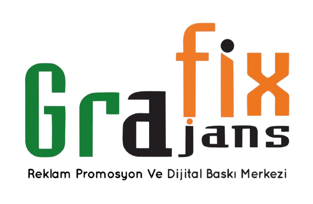

<div align="center">

  

  # GRAFİX AJANS 🚀
  ### Reklam, Promosyon ve Dijital Baskı Merkezi Web Sitesi & Yönetim Paneli

  [](https://grafixajans.netlify.app/)
  [](https://firebase.google.com/)
  [](https://cloudinary.com/)
  [](https://developer.mozilla.org/en-US/docs/Web/JavaScript)

  <p align="center">
    <strong>Uşak'ta 2005'ten beri profesyonel reklam ve dijital baskı çözümleri üreten Grafix Ajans'ın modern web sitesi ve kod bilgisi gerektirmeyen dinamik içerik yönetim paneli.</strong>
  </p>

  <p align="center">
    <a href="https://grafixajans.netlify.app/" target="_blank">🌐 Canlı Siteyi Görüntüle</a> •
    <a href="#-özellikler">✨ Özellikler</a> •
    <a href="#-yönetici-paneli-admin-cms">🛠️ Yönetici Paneli</a> •
    <a href="#-teknoloji-yığını">💻 Teknolojiler</a> •
    <a href="#-kurulum--yerel-çalıştırma">⚙️ Kurulum</a>
  </p>

</div>

---

## 📌 Proje Genel Bakışı

Bu proje, **Grafix Ajans** için özel olarak geliştirilmiş kurumsal bir web platformudur. Ziyaretçilere hızlı, modern ve etkileşimli bir deneyim sunarken; işletme sahibinin/yöneticinin hiçbir teknik kod bilgisine ihtiyaç duymadan yeni işlerini, tabelalarını, araç kaplamalarını ve promosyon çalışmalarını kolayca web sitesine ekleyip yönetebilmesini sağlar.

---

## ✨ Özellikler

### 🎨 1. Ziyaretçi Deneyimi (Frontend)
- **Modern & Akıcı Tasarım:** Inter & Playfair Display tipografisi, kurumsal renk paleti ve modern gölge/kart hiyerarşisi.
- **GSAP & Smooth Scroll:** Akıcı kaydırma (Lenis Scroll) ve dinamik metin/bölüm animasyonları.
- **Dinamik Kategori Filtreleme:** Işıklı/Işıksız Tabela, Totem, Araç Kaplama, Dijital Baskı, Promosyon, UV Baskı, Metal Markalama vb. sekmeleri arasında anında geçiş.
- **Sabit Boyutlu Sinematik Medya Görüntüleyici:**
  - Farklı en-boy oranlarındaki (dikey totem veya yatay cephe) tüm fotoğraf ve videoları **sabit, dengeli (960x640px) ve çerçevesiz** bir sahnede açar.
  - Önceki / Sonraki ok tuşları ve klavye kısayolları ile kesintisiz gezinme imkanı.
- **Hızlı İletişim:** Tek tıkla WhatsApp üzerinden doğrudan mesajlaşma ve telefonla arama aksiyonları.
- **%100 Responsive:** Mobil cihazlar, tabletler ve geniş masaüstü ekranlar için optimize edilmiş esnek grid yapısı.

---

### 🛠️ 2. Yönetici Paneli (Admin CMS - `admin.html`)
- **Güvenli Giriş Sistemi:** Firebase Authentication altyapısı ile yalnızca yetkili yöneticinin e-posta ve şifreyle erişebildiği güvenli panel.
- **Sürükle & Bırak Yükleme:** Aynı anda birden fazla fotoğraf veya video seçme/sürükleme desteği.
- **İstemci Taraflı Akıllı Sıkıştırma (Client-side Canvas WebP/JPEG):**
  - Telefon kamerasıyla çekilen 8-10 MB'lık yüksek çözünürlüklü fotoğraflar, tarayıcı içinde kalite kaybı olmaksızın otomatik olarak **~150-250 KB** boyutuna optimize edilir.
  - Bu sayede bulut depolama kotası korunur, site ziyaretçiler için ışık hızında açılır.
- **Anlık Canlı Yayına Alma:** Panelden yüklenen bir görsel anında Cloudinary ve Firestore'a işlenir; `calismalarimiz.html` sayfasının en başında yayınlanır.
- **Medya Yönetimi & Silme:** Sitedeki tüm çalışmaları arama, filtreleme, önizleme ve tek tıkla kalıcı olarak silme.
- **Gizli Yönetici Erişimi:** Footer'ın en altında yer alan zarif `🔒 Yönetici Girişi` bağlantısı üzerinden panele kolay erişim.

---

## 💻 Teknoloji Yığını

| Alan | Kullanılan Teknoloji / Kütüphane | Amaç |
| :--- | :--- | :--- |
| **İşaretleme & Stil** | HTML5, CSS3, Flexbox & CSS Grid | Semantik, modern ve responsive yapı |
| **Programlama** | Modern Vanilla JavaScript (ES6+) | Hızlı, framework bağımlılığı olmayan temiz kod |
| **Kimlik Doğrulama** | Firebase Authentication | Güvenli e-posta/şifre yönetici girişi |
| **Veritabanı** | Cloud Firestore | Çalışmaların başlık, kategori ve URL'lerini saklama |
| **Medya Depolama** | Cloudinary Media CDN | Ücretsiz 25 GB görsel/video barındırma & hızlı CDN dağıtımı |
| **Animasyon & Efektler** | GSAP, ScrollTrigger, Swiper, Lenis | Pürüzsüz animasyonlar ve slider bileşenleri |
| **İkonlar** | Font Awesome 6 | Vektörel modern arayüz ikonları |
| **Hosting & Dağıtım** | Netlify | Global CDN üzerinde sürekli dağıtım (CI/CD) |

---

## 📁 Proje Dosya Yapısı

```bash
yenigrafix/
├── images/                   # Kurumsal logolar, arka planlar ve çalışma görselleri
│   ├── ÇALIŞMALARIM/         # Portfolyo fotoğrafları ve videoları
│   ├── grafix-logo.png       # Orijinal Grafix Ajans logosu
│   └── hero-bg-cropped.jpg   # Hero arka plan görseli
├── admin.html                # Yönetici yönetim paneli (Giriş, yükleme, silme)
├── calismalarimiz.html       # Filtreli, dinamik portfolyo sayfası
├── firebase-config.js        # Firebase & Cloudinary yapılandırma anahtarları
├── index.html                # Ana sayfa (Hizmetler, Öne çıkanlar, Referanslar)
├── project-detail.html       # Örnek proje detay sayfası
└── README.md                 # Proje dokümantasyonu
```

---

## ⚙️ Kurulum & Yerel Çalıştırma

Projeyi bilgisayarınızda çalıştırmak için herhangi bir ekstra paket yöneticisine (npm/yarn) ihtiyaç yoktur:

1. **Repoyu klonlayın:**
   ```bash
   git clone https://github.com/Firdevs64/grafix-ajans-web-sitesi.git
   cd grafix-ajans-web-sitesi
   ```

2. **Yerel bir sunucu başlatın:**
   - **Python ile:**
     ```bash
     python -m http.server 8000
     ```
   - **Node.js ile:**
     ```bash
     npx serve .
     ```

3. **Tarayıcınızda açın:**
   - Ana Sayfa: `http://localhost:8000`
   - Yönetici Paneli: `http://localhost:8000/admin.html`
   - Çalışmalarımız: `http://localhost:8000/calismalarimiz.html`

---

## 🚀 Netlify Üzerinden Canlıya Alma

Proje Netlify ile tam entegre çalışacak şekilde tasarlanmıştır:

1. **GitHub Bağlantısı ile (Otomatik):**
   - [app.netlify.com](https://app.netlify.com) adresine giriş yapın.
   - **"Add new site" > "Import an existing project"** seçeneğini seçin.
   - `Firdevs64/grafix-ajans-web-sitesi` reposunu bağlayın.
   - Build ayarı gerekmez (statik HTML); **"Deploy site"** butonuna basmanız yeterlidir. Her git push işleminde siteniz otomatik güncellenir.

2. **Manuel Sürükle & Bırak ile (Netlify Drop):**
   - Netlify panelinizde sitenizin **"Deploys"** sekmesine gelin.
   - Proje klasörünü ilgili alana sürükleyip bırakarak 10 saniyede güncelleyebilirsiniz.

---

## 📄 Lisans & Telif Hakkı

© 2026 **Grafix Ajans**. Tüm hakları saklıdır.  
Görseller ve marka varlıkları Grafix Ajans'a aittir.
